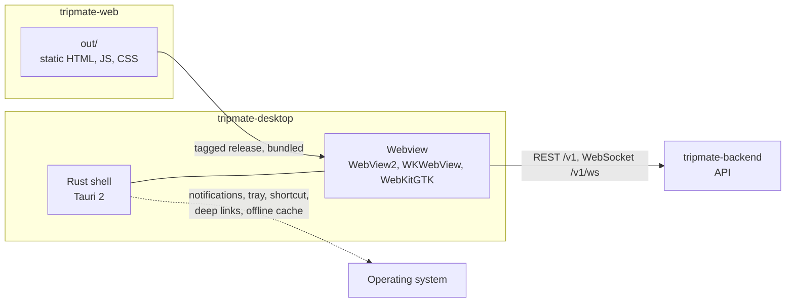
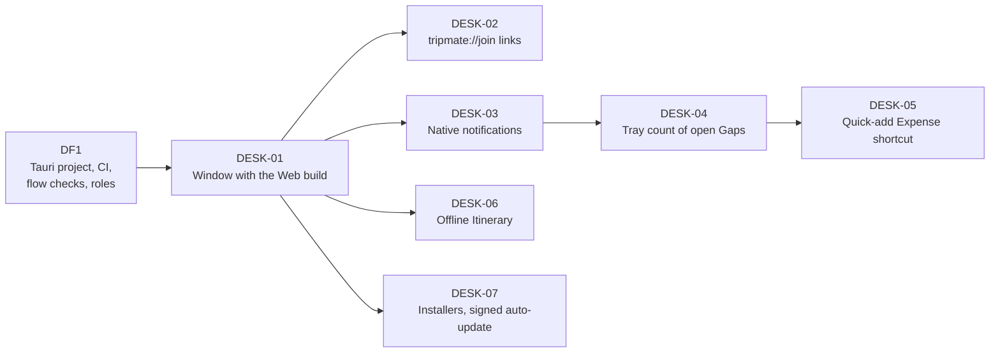

# tripmate-desktop

The TripMate Desktop client for macOS, Windows, and Linux. It is a
Tauri 2 shell in Rust that runs the static build of `tripmate-web` in a
native window, and adds only what the PRD lists for Desktop: links that
open the app, native notifications, a tray, a quick-add shortcut, an
offline Itinerary, and signed updates.

| | |
|---|---|
| Status | Tauri project and CI in place (EPIC-11, card DF1). The window shows a placeholder page; the Web build loads in DESK-01 (EPIC-12). |
| Product documents | [tripmate-docs](https://github.com/huynguyennang-agilityio/tripmate-docs) |
| Rules for contributors and AI agents | [CLAUDE.md](CLAUDE.md) |
| Tasks of this repository | [tasks/EPIC-11.md](tasks/EPIC-11.md) |

## Contents

- [Architecture](#architecture)
- [Tech stack](#tech-stack)
- [Code structure](#code-structure)
- [Getting started](#getting-started)
- [Checks and CI](#checks-and-ci)
- [Roadmap of this repository](#roadmap-of-this-repository)
- [Further reading](#further-reading)

## Architecture

### Where Desktop sits



- **The screens are the Web build.** Desktop bundles a tagged release of
  `tripmate-web`, so it always ships a known Web version.
- **The shell does only what the PRD lists** (DESK-01 to DESK-07). It runs
  no money, voting, or Gap logic: the backend owns the rules.
- **No secrets in the client.** The repository and the app are public.
- **The web view may call only what a capability allows.** Today the main
  window has no permission at all (an empty list in
  `capabilities/default.json`); each card adds only the permissions it uses.

The full picture is in
[architecture.md](https://github.com/huynguyennang-agilityio/tripmate-docs/blob/main/docs/architecture.md),
section 8.3.

## Tech stack

Versions are in `Cargo.toml` and locked in `Cargo.lock`, so every machine
and CI build the same thing.

| Area | Tool | Version | Notes |
|------|------|---------|-------|
| Language | Rust | 1.100.0 | Pinned in `rust-toolchain.toml`, with `clippy` and `rustfmt`; edition 2024 |
| Framework | Tauri | 2.12.7 (`tauri`), 2.7.6 (`tauri-build`) | No Tauri plugin yet; DESK-02 and later add them |
| Webview | WebView2, WKWebView, WebKitGTK | The system's | Windows, macOS, Linux |
| Lint | Clippy | Of the pinned toolchain | `-D warnings`, default lint set |
| Tests | `cargo test` | | Unit tests in `src/`, integration tests in `tests/` |
| Scripts | Node.js | 24 | Only `scripts/` and the hook; no `package.json` |
| CI | GitHub Actions | `actions/checkout` v7.0.1, `Swatinem/rust-cache` v2.9.3 | Pinned to commit SHAs in `.github/workflows/` |

## Code structure

```text
tripmate-desktop/
├── .claude/agents/          The four agent roles: test, code, test-check, diff review
├── .claude/hooks/           Checks before a push
├── .github/
│   ├── workflows/           ci.yml, flow.yml, risk-gate.yml
│   └── risk-paths.toml      Path list of the risk gate
├── capabilities/            What the web view may call
├── icons/                   App icons
├── scripts/
│   └── check-line-endings.mjs   Fails on any CRLF or changed file (Node only)
├── src/
│   ├── main.rs              Entry point
│   └── lib.rs               pub fn run(), the Tauri builder
├── tasks/                   Task files and review notes
├── tests/                   Integration tests of the test agent (from DESK-01)
├── ui/index.html            Placeholder page until DESK-01
├── build.rs, Cargo.toml, Cargo.lock, rust-toolchain.toml
├── tauri.conf.json          Window and bundle settings
├── .gitattributes           LF on every OS; images and fonts are binary
└── CLAUDE.md                Rules for contributors and AI agents
```

The crate is at the repository root, so Cargo's `tests/` folder is the
folder the flow checks treat as tests.

## Getting started

You need Git, `rustup`, and the Tauri 2 prerequisites of your platform
(listed in [CLAUDE.md](CLAUDE.md), "Setup"): on Windows the Visual Studio
Build Tools with the C++ workload and WebView2, on macOS the Xcode
Command Line Tools, on Linux a few system packages.

```sh
git clone https://github.com/huynguyennang-agilityio/tripmate-desktop.git
cd tripmate-desktop
cargo run          # builds, then opens a window with the placeholder page
```

The first `cargo` command installs the toolchain of `rust-toolchain.toml`.
On Windows, no Git setting is needed: `.gitattributes` keeps every file LF
whatever `core.autocrlf` is.

## Checks and CI

Run the same checks as CI before opening a pull request:

| Command | What it does | CI check (required on `main`) |
|---------|--------------|-------------------------------|
| `cargo clippy --all-targets -- -D warnings` | Clippy's default lints; any warning fails | `clippy` |
| `cargo test` | Unit and integration tests | `test` |
| `node scripts/check-line-endings.mjs` | Fails on a changed file or any non-LF text file | -- |

CI runs on every pull request and on every push to `main`, with
`--locked`. The flow checks (`flow / failing-first`, `flow / test-lock`,
`gate / risk-gate`) are required on `main` too; see
[CLAUDE.md](CLAUDE.md), "Flow checks".

### Checks before a push

A Claude Code hook runs the local checks before Claude runs `git push`
or `gh pr create` in this repository, and blocks the command when one
fails, with the failing output. It is registered in
`.claude/settings.json` and lives in
`.claude/hooks/check-before-push.mjs`.

| Check | Runs |
|-------|------|
| `node scripts/check-line-endings.mjs`: no changed file, and every text file LF | Always |
| `cargo clippy --all-targets -- -D warnings` | Once a `Cargo.toml` exists at the root or in `src-tauri/` |
| `cargo test` | Once a `Cargo.toml` exists at the root or in `src-tauri/` |

Deleting a remote branch is not checked. The hook needs Node.js; CI
stays the gate on `main`.

`.gitattributes` stores and checks out every text file with LF on every
OS, whatever `core.autocrlf` is.

## Roadmap of this repository



DF1 and its test cases are in [tasks/EPIC-11.md](tasks/EPIC-11.md); the
DESK cards are in EPIC-12.

## Further reading

| Question | Document |
|----------|----------|
| How to work in this repository | [CLAUDE.md](CLAUDE.md) |
| What TripMate must do | [prd.md](https://github.com/huynguyennang-agilityio/tripmate-docs/blob/main/prd.md) |
| How the system fits together | [architecture.md](https://github.com/huynguyennang-agilityio/tripmate-docs/blob/main/docs/architecture.md) |
| Security rules for clients | [security.md](https://github.com/huynguyennang-agilityio/tripmate-docs/blob/main/docs/security.md) |
| How it is tested | [test-strategy.md](https://github.com/huynguyennang-agilityio/tripmate-docs/blob/main/docs/test-strategy.md) |
| How a card goes from task to merge | [development-flow.md](https://github.com/huynguyennang-agilityio/tripmate-docs/blob/main/docs/development-flow.md) |
| Domain terms | [GLOSSARY.md](https://github.com/huynguyennang-agilityio/tripmate-docs/blob/main/GLOSSARY.md) |
